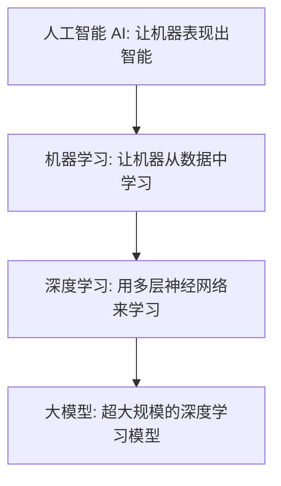
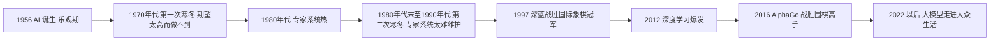

# 第 1 章 什么是 AI

> **本章你会弄明白:**
> AI 到底是什么?它和"普通的电脑程序"有什么区别?AI 的历史为什么像过山车?"强 AI"和"弱 AI"又是什么意思?

---

## 1.1 从一台自动售货机说起

先来看一台自动售货机。你投一块钱,按下"可乐"按钮,可乐就掉下来了。它聪明吗?

它有点像"聪明",因为它能"判断"你投的钱够不够、你按的是哪个按钮、可乐还有没有货。但你稍微想想就知道,它并不聪明:它内部只是一堆写死的规则——

- 如果投币 ≥ 3 元,并且按了"可乐",并且可乐有货,就掉出一瓶。
- 否则,什么也不发生。

这些规则是工程师一条一条写好的,它永远不会"自己学到新东西"。你往里投一枚外国硬币,它多半会原样吐出来,因为规则里没写。

再来看第二个例子。你用手机相册搜索"猫",相册立刻把所有有猫的照片找出来了,包括那只躲在沙发后面、只露出半个脑袋的猫。

这一次,谁写了规则?没有人。没有哪个工程师写过"如果图片里有两个三角形耳朵,再加几根胡须……"。这个功能背后的程序,是**看了几百万张带标签的图片之后,自己总结出了"猫长什么样"**。

这两个例子,恰好对应了两种完全不同的"智能"。

## 1.2 两种智能:写出来的,和学出来的

| | 规则式(写出来的) | 学习式(学出来的) |
|---|---|---|
| 知识从哪来 | 人类专家把经验写成规则 | 机器从大量数据里自己总结 |
| 典型例子 | 自动售货机、红绿灯定时器、早期"专家系统" | 人脸识别、语音助手、ChatGPT 之类 |
| 优点 | 清楚、可靠、好检查 | 能处理模糊、复杂、说不清的问题 |
| 缺点 | 规则写不完,遇到新情况就傻眼 | 需要大量数据,有时说不清为什么这么判断 |

**早期的 AI 研究者,很长一段时间都在走"写规则"这条路。** 比如 20 世纪 70、80 年代很流行的**专家系统**:找来医生,把"如果发烧加咳嗽加……就可能是某某病"之类的经验整理成几千条规则,让电脑去帮着诊断。

听起来很合理,对吧?结果呢?

- 医生的经验很难完全说清楚,"这个病人看着不太对劲"这种直觉,怎么写成规则?
- 规则越写越多,条条之间还会互相打架。
- 稍微出现一个没见过的情况,系统就给出离谱的答案。

于是人们逐渐意识到:**与其教机器每一条规则,不如让机器自己从例子里学。** 这条路,就是今天"机器学习"和"深度学习"的出发点。

## 1.3 那么,到底什么是 AI?

**人工智能(Artificial Intelligence,简称 AI)**,可以先用一句大白话概括:

> **让机器去做那些通常需要人类智能才能做的事情。**

比如:

- **看**:认出图片里是什么、看懂路况。
- **听**:听懂人说话。
- **说/写**:翻译、聊天、写文章。
- **思考与决策**:下棋、规划路线、判断风险。
- **行动**:机器人走路、无人机避障。

"AI"其实是一个很大的"家族名字",里面有好几层:

- **人工智能**:最大的圈,只要让机器表现得"有点聪明",都算。
- **机器学习**:AI 的一种主流办法,核心是"从数据里学规律"。
- **深度学习**:机器学习里最强的一支,用一种叫"神经网络"的结构,层层叠叠地学。
- **大模型**:深度学习发展到极大规模之后的产物,比如能聊天的 ChatGPT 类产品。

所以,当别人说"AI"的时候,你可以在心里默默问一句:**他说的是哪一层?** 大多数时候,今天说的 AI,指的都是里面的"机器学习"与"深度学习"。

## 1.4 一个有趣的问题:机器怎样才算"聪明"?

1950 年,英国数学家**艾伦·图灵**写了一篇著名的论文,提出了一个有点"耍赖"的想法:

> 既然"智能"很难下定义,那就来个测试:
> 让一个人和一台机器、一个真人分别隔着屏幕跟你聊天。如果你聊了很久,也分不清哪个是机器,那我们就可以认为,这台机器"表现得像是有智能"。

这就是著名的**图灵测试**。注意,图灵没有说机器"真的会思考",他只是说:**如果从行为上看不出区别,那就不必争论它是不是'真的'聪明。**

你可以现在就试着想一想:你和某个聊天机器人聊了半小时,你能分出来它是机器吗?这个问题,直到今天依然让人争论不休。

## 1.5 AI 的过山车历史

AI 这个词是在 **1956 年的达特茅斯会议**上被正式提出的。当时几位年轻的科学家聚在一起,信心满满地说:"我们大概花一个暑假,就能让机器学会像人一样思考吧!"

结果呢?他们大大低估了难度。AI 的历史大概可以画成一条上上下下的曲线:

### 第一次繁荣与寒冬

最早的 AI 程序能解几何题、下简单的棋、做简单的对话。人们很兴奋,觉得"几十年内机器就会无所不能"。可是一到真实世界,问题就来了:真实世界太复杂、太乱,电脑当时又慢、内存又小,AI 一下子"碰了壁"。研究经费被削减,这个时期被叫作"**AI 寒冬**"。

### 第二次繁荣:专家系统

20 世纪 80 年代,专家系统让 AI 火了一把,不少公司用它来辅助诊断、配置电脑。但就像前面说的,规则写不完、维护成本太高,热度又一次退去,这是第二次寒冬。

### 深蓝:靠"算得快"赢棋

1997 年,IBM 的"**深蓝**"超级计算机战胜了国际象棋世界冠军卡斯帕罗夫,全世界为之震惊。

但深蓝的"聪明"主要来自**暴力计算**:每秒能检查上亿种走法,再根据人类专家设计的评分规则来挑选。它不是"学会"下棋,而是"算得快",这是规则式智能的巅峰。

### 深度学习的爆发

真正的转折点是 2012 年前后。几个条件同时成熟了:

1. **数据多了**:互联网产生了海量的图片、文字、语音。
2. **算力强了**:原本用来打游戏的显卡(GPU),恰好很适合做神经网络需要的大量计算。
3. **算法好了**:研究者们改进了训练神经网络的办法。

在 2012 年的一场图像识别比赛里,一个叫 AlexNet 的深度神经网络把成绩一下拉开了对手一大截。(这个故事我们在第 5 章细讲。)从此,AI 研究的大方向彻底转向了"让机器从大量数据里学"。

### AlphaGo:靠"学会"赢棋

2016 年,谷歌旗下 DeepMind 公司开发的 **AlphaGo** 战胜了世界顶尖的围棋棋手李世石。围棋的可能局面比宇宙里的原子还多,暴力计算根本行不通。AlphaGo 靠的是**从大量棋谱学习,再自己和自己下很多盘棋来提高**。

深蓝是"算得快",AlphaGo 是"学得好",两者的区别,恰恰是整个 AI 史的缩影。

### 大模型的时代

2022 年底以后,能和人流畅对话、写文章、写程序的**大模型**开始走进普通人的生活。AI 不再只是实验室里的东西,而变成了很多人每天都会用的工具。后面的章节,我们会专门讲它是怎么来的。

## 1.6 "弱 AI"与"强 AI"

你可能在科幻电影里见过那种有自我意识、想要毁灭人类的机器人。那和我们现在的 AI 一样吗?

科学家通常把 AI 分成两类概念:

- **弱 AI(也叫专用 AI)**:只在特定任务上很强。比如会下围棋的 AlphaGo,下棋之外什么都不会;人脸识别系统,只会认脸。今天几乎所有我们见到的 AI,从本质上说,都属于这一类,哪怕大模型已经能做很多种事情,它们仍然是在"处理文字与图像模式"的意义上工作,并没有被证明拥有自我意识。
- **强 AI(也叫通用人工智能,AGI)**:像人一样,能学习各种技能,能理解、能迁移、能自主设定目标。这是很多科学家的长期梦想,但目前仍没有人真正做到,"到底什么时候能做到""到底算不算做到了",科学家之间还有很大的争论。

所以请记住:**今天的 AI 是非常厉害的工具,但它不是电影里那种有欲望、有意识的"生命"。**

## 1.7 为什么这件事和你有关?

也许你会想:"我又不当科学家,为什么要懂这些?"

- 因为你的生活里,已经充满了 AI:推荐视频、地图导航、拍照美颜、翻译、聊天助手。
- 因为你将来的学习与工作,很可能要和 AI 合作。懂一点原理,你就能知道**它擅长什么、不擅长什么,什么时候该相信它,什么时候要多留个心眼**。
- 最重要的是,这是人类历史上最有趣的一场科学冒险之一,而你正好站在它的开头。

---

## 1.8 一天 24 小时,AI 在哪里?

我们来"跟拍"一个普通高中生小林的一天,数一数她遇到了多少 AI:

- **早上 6:30**,手机闹钟响了。她对着手机说"关掉闹钟,明天也这个点叫我"。**语音识别**把声音变成文字,**语言理解**弄懂她的意思。
- **7:00**,地图软件告诉她"今天某路段拥堵,建议提前 10 分钟出发"。它综合了大量车辆的实时位置,**预测**路况。
- **8:00**,校门口的闸机"刷脸"放行。**人脸识别**,一种计算机视觉。
- **课间**,她用翻译软件读一篇英文科普文章,**神经机器翻译**。
- **中午**,外卖软件推荐了她可能喜欢的菜,**推荐系统**(第 9 章)。
- **下午**,生物课上老师用手机"识花"软件认出校园里一株不认识的植物。
- **晚上**,她用聊天机器人检查数学作业的思路,又刷了一会儿短视频,**推荐系统**再次登场。
- **睡前**,手机相册把今天拍的照片,自动归类成"校园""美食""宠物"。

一天里,至少 8 次。而且你会发现:**这些 AI 大多不是"一个整体的 AI",而是一个个专门干某件事的小模型**——有人负责听,有人负责看,有人负责猜你喜欢什么。这正是接下来几章要逐一拆开讲的。

## 1.9 关于 AI 的五个常见误会

在继续之前,先澄清几个很多人心里的"想当然":

**误会一:AI 就是机器人。**
机器人是"身体",AI 是"大脑"(之一)。你手机里的语音助手、推荐算法,根本没有身体。很多机器人(比如工厂里的机械臂)也不一定用了 AI。

**误会二:AI 无所不知。**
AI 只"知道"它训练数据里有的东西(而且不总是准确的)。它没见过的东西,它不知道;它见过但被错误标注的东西,它会学错。第 11 章会专门讲它"一本正经地胡说"的毛病。

**误会三:AI 会像人一样"想"。**
今天的 AI,本质上是**从数据里找规律并据此预测**。它给出答案的过程,和人"思考"的过程,有相似之处,也有很大差别。到底算不算"真的在思考",科学家们至今还在争论。

**误会四:AI 很快就会取代所有人的工作。**
AI 会改变很多工作的方式,有些重复性强的任务会被自动化,但同时也会产生新的工作。历史上每一次技术革命(蒸汽机、电力、互联网)都是如此。更现实的说法是:**会用 AI 的人,会比不会用的人更有优势。**

**误会五:AI 是中立客观的。**
AI 学自人类留下的数据,数据里的偏见会被带进模型;AI 的设计者设定的目标,也会影响它的行为。所以"AI 说的"不等于"客观真理"。

## 本章小结

- **AI** 是让机器去做通常需要人类智能的事。
- 智能有两种来路:**人写规则**,或者**机器从数据里学**。今天主流 AI 是后者。
- AI 家族结构:人工智能 ⊃ 机器学习 ⊃ 深度学习 ⊃ 大模型。
- AI 历史经历了**乐观—寒冬—再乐观—再寒冬—爆发**的过山车。关键转折来自数据、算力、算法三者同时成熟。
- 今天的 AI 属于"**弱 AI**",强大但有明确边界。

## 想一想

1. 你手机里,哪些功能是"写规则"的,哪些是"学出来"的?试着各举三个。
2. 深蓝和 AlphaGo 都赢了人类,你觉得它们赢的方式有什么本质不同?
3. 如果你和一个聊天机器人聊天,你会问它什么问题,来判断它是不是人?

---

下一章:[什么是算法与模型](ch02.md)
