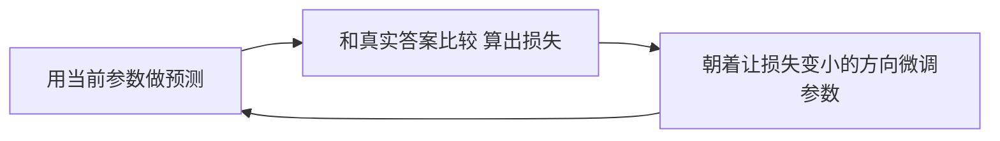

# 第 2 章 什么是算法与模型

> **本章你会弄明白:**
> 算法是什么?为什么说它像菜谱?"模型"和"训练"又是怎么回事?机器怎样靠"猜错再改"一点点变聪明?

---

## 2.1 先煮一碗泡面

你要给一个从没做过饭的外星人介绍怎么煮泡面。你会怎么说?

1. 烧一锅水,约 500 毫升。
2. 水开了,放入面饼。
3. 煮 3 分钟。
4. 加入调料包。
5. 关火,盛出。

这就是一个**算法**。

> **算法:解决一个问题的、清晰的、一步一步的办法。**

关键词有三个:**清晰**(每一步都明确,不能含糊)、**一步一步**(有顺序)、**能解决问题**(最后有结果)。

算法不是电脑专属的。你早上整理书包、问路时听到"直走,第二个路口右转",都是算法。电脑里的算法,只是用电脑能懂的语言把这些步骤写出来。

## 2.2 一个经典例子:猜数字

我心里想一个 1 到 100 之间的数,你来猜,我只告诉你"大了"或"小了"。怎么才能最快猜出来?

**笨办法:** 从 1 开始一个个猜,最坏要猜 100 次。

**聪明办法(二分法):** 每次都猜中间的数。

- 猜 50 → "大了" → 范围缩小到 1~49。
- 猜 25 → "小了" → 范围缩小到 26~49。
- 猜 37 → "大了" → 范围缩小到 26~36……

每次都能把范围砍掉一半,最多只要 **7 次**就能猜到。

这个例子说明了:**同一个问题,不同的算法,效率天差地别。** 好算法就像好方法,能让电脑少做无用功。

## 2.3 可是,有些问题,没法"写"出算法

现在换一个任务:**判断一封邮件是不是垃圾邮件。**

你可能会开始写规则:

- 如果邮件里有"免费领奖",就是垃圾邮件。
- 如果有"中奖",就是垃圾邮件。
- 如果……

可很快你会发现:

- 垃圾邮件发送者会改成"免 费 领 奖"或者"免费领讲"来绕开你。
- 正常邮件里也可能出现"中奖"二字,比如朋友告诉你:"我居然中奖了!"
- 规则永远在被绕过,你永远在追着改。

这时候,换一种思路:**不去写规则,而是给电脑看一大堆例子**——这些是垃圾邮件,这些不是——让它自己去总结哪些词、哪些特点更像垃圾邮件。

- 它可能发现:"免费"这个词在垃圾邮件里出现的比例是正常邮件的 40 倍。
- 它可能发现:邮件里有很多感叹号的,垃圾的可能性更大。
- 它把这些线索加权综合,最后给出一个"垃圾邮件概率",比如 97%。

这种"**不写规则,而从例子里学规律**"的办法,就是**机器学习**。

## 2.4 什么是"模型"?

在机器学习里,你经常会听到一个词:**模型**。它是什么?

打个比方。你想预测明天奶茶店能卖几杯。经过观察,你发现:**气温越高,卖得越多**。

你可以把这个经验写成一个简单的"公式":

> 销量 ≈ 20 + 3 × 气温

意思是:气温每升高 1 度,大概多卖 3 杯;气温为 0 度时,也能卖 20 杯左右。

这个"经验公式",就是一个**模型**。

> **模型:对世界规律的一个简化的、可以用来做预测的"经验公式"。**

这个公式里有两个数字:**20** 和 **3**。它们叫做**参数**。你可以想象成收音机上的**旋钮**:

- 旋钮拧到不同位置,公式给出的预测就不同。
- 好的旋钮位置,预测准;差的旋钮位置,预测偏。

**机器学习要做的事情,就是自动找到最合适的旋钮位置。**

在简单问题里,只有两三个旋钮。可是在今天的大模型里,有**几百亿甚至上万亿个旋钮**,听着很吓人,但思路和奶茶那个小公式是一模一样的。

## 2.5 "训练":怎么拧旋钮?

假设我们一开始随便猜了一个公式:

> 销量 ≈ 0 + 1 × 气温

我们拿昨天的数据去检验:昨天气温 30 度,实际卖了 110 杯,而公式预测只有 30 杯。**差了 80 杯!**

这个"差距",在机器学习里有个专门的名字:**损失(Loss)**。损失越大,说明模型越差;损失越小,说明模型越好。

于是,训练的过程就是:

1. **预测**:用现在的旋钮位置做一次预测。
2. **算损失**:看看预测和真实答案差多少。
3. **调旋钮**:朝着让损失变小的方向,稍微拧一拧。
4. **重复**:再来一遍,再来一遍……

这样重复几千、几百万、几十亿次,旋钮就会慢慢停在一个很不错的位置。**这个过程,就叫"训练"。**

### 怎么知道"往哪边拧"?——蒙眼下山

这里有个关键问题:机器怎么知道旋钮是该往左拧还是往右拧?

想象你被蒙住眼睛,站在一座起伏的山上,你的目标是走到**最低的山谷**(也就是损失最小的地方)。你看不到整个地形,但你能感觉到**脚下这块地是朝哪个方向倾斜的**。

于是你只需要一直做这件事:**朝着脚下最陡的下坡方向,迈一小步。** 一步,一步,再一步,最终你就会走到山谷。

这个办法,叫做**梯度下降**("梯度"就是"坡度的方向")。它是整个深度学习里最核心的训练思路之一。你不需要懂公式,只要记住:

> **训练就是:蒙着眼睛,凭脚下的坡度,一小步一小步走到山谷。**

### 亲手"下山"试一试

下面这个小程序,把"蒙眼下山"变成了你可以玩的游戏。曲线是**损失**(越低越好),小球就是我们的模型,它所在的横坐标,就是某个参数的当前取值。

试试这几件事:

1. 点一下"走一步",看小球怎样朝着**下坡方向**挪动;再点"自动下山"看它一路走到谷底。
2. 把**学习率**调得很小(比如 0.01),观察:太慢了!
3. 把学习率调大,看它在谷底**来回震荡**;再大一点,它会直接**飞出去**。
4. 点击曲线上不同的位置,换个起点出发。**你会发现,有时它落在了较浅的山谷里,没有走到最深处**——这叫"局部最小值"。

<GradientDescent />

学习率就是"每一步迈多大"。步子太小,走到天黑也到不了;步子太大,一步迈过山谷、冲到对面的山坡上,甚至越走越高。**怎么选好学习率,是训练神经网络时最重要的"手艺"之一。**

当然,真实的山不是一座,而是在**几亿维**的空间里,有无数个山谷。我们后面会看到,研究者们花了很多心思来让这个"下山"过程更快、更稳。

## 2.6 训练完了,怎么用?

训练完成之后,我们把旋钮固定下来,这个模型就可以用来做预测了。

- **训练阶段**:需要大量数据,耗时耗电,通常很贵。就像学生"寒窗苦读"。
- **推理阶段**(也叫使用或预测):拿新的数据输入模型,模型输出答案。很快、很便宜。就像学生"走进考场答题"。

你和聊天机器人说话的时候,它正在做"推理";而它在训练的时候,是在一个巨大的机房里"读书",花了好几个月。

## 2.7 小结一下:AI 算法的"三件套"

不管 AI 多复杂,几乎都离不开下面三样东西:

| 三件套 | 比喻 | 例子 |
|---|---|---|
| **数据** | 教材、练习题 | 几百万张猫的图片、海量的文字 |
| **模型** | 带旋钮的"经验公式" | 神经网络,以及它的几十亿个参数 |
| **训练算法** | 拧旋钮的办法 | 梯度下降、反向传播 |

后面每一章的"让机器会看、会听、会说、会行动",其实只是**换了不同的数据、设计了不同形状的模型**而已。思路万变不离其宗。

---

## 2.8 好算法和坏算法:不只是"能算出来"

回到最开始的"猜数字"。笨办法最多猜 100 次,二分法最多猜 7 次。如果数字范围扩大到 **10 亿**呢?

| 范围 | 笨办法最多猜 | 二分法最多猜 |
|---|---|---|
| 100 | 100 次 | 7 次 |
| 100 万 | 100 万次 | 20 次 |
| 10 亿 | 10 亿次 | 30 次 |

范围扩大一千万倍,二分法只多猜了 23 次!这是**算法效率**的魅力。计算机科学家用"**时间复杂度**"来衡量一个算法在问题规模变大时,需要的时间"增长得有多快"。

> 一个好算法,可以让一台普通电脑,比用坏算法的超级计算机还快。

机器学习里也一样:**同样的训练目标,用更聪明的优化算法,可能让训练时间从几个月缩短到几天。** 后面你会看到,很多 AI 的突破,其实是算法上的巧思(比如第 5 章 ResNet 的"捷径"、第 10 章 Transformer 的"并行"),让原来"算不动"的事情变成了"算得动"。

## 2.9 模型有多大?从 2 个旋钮到上千亿个旋钮

我们说模型就是"带旋钮的经验公式",那旋钮的数量,就是模型大小的一个粗略标尺。

| 模型 | 旋钮(参数)数量 | 类比 |
|---|---|---|
| 奶茶销量公式 | 2 个 | 收音机上的两个旋钮 |
| 识别手写数字的小网络 | 几万到几十万个 | 一架大型调音台 |
| 识别猫狗的 CNN(AlexNet,2012) | 约 6000 万个 | 一整座小城市的路灯开关 |
| 大语言模型(如 GPT-3,2020) | 约 1750 亿个 | 全球每 1 个人对应 20 多个旋钮 |

规模变大,**能学到的东西也更多、更细**;但代价是:**需要的数据更多,训练的电费更贵,出错时也更难排查**。第 10 章我们会看到,这恰恰是"大模型"得名的原因。

## 本章小结

- **算法**:一步一步、清晰的解题办法,像菜谱。
- 有些问题没法"写"出算法,这时就用**机器学习**:从例子里学规律。
- **模型**是带"旋钮"(参数)的经验公式。
- **训练**:预测 → 算损失 → 调旋钮 → 重复。**梯度下降**就是"蒙眼下山"。
- 训练贵而慢,**推理**(使用)则快得多。

## 想一想

1. 请你设计一个"预测明天你回家路上会不会堵车"的简单模型:你会用哪些数据?哪些是"旋钮"?
2. 为什么说"损失"越小越好?如果损失永远为零,是好事还是可疑?(下一章会给你线索。)
3. 把二分猜数字的办法用到查字典上,你觉得可行吗?为什么?

---

下一章:[机器如何学习](ch03.md)
