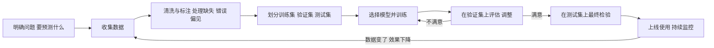

# 第 3 章 机器如何学习

> **本章你会弄明白:**
> 机器学习有哪几种"学法"?为什么机器也会"死记硬背"?怎样判断它是真学会了,还是在作弊?

---

## 3.1 三个学生的故事

想象三个不同的学生,他们的学习方式各不相同。

- **小明**:做作业,每道题做完都有老师批改,告诉他"对"或"错",还会给出正确答案。
- **小红**:没有老师,她面前有一堆衣服,她自己决定"这些是 T 恤、这些是裤子、这些是外套",自己分门别类。
- **小刚**:玩一款闯关游戏,没人告诉他怎么玩,他只能不停尝试,**得分了就知道做对了,掉进坑里就知道做错了**。

这三个学生,恰好对应了机器学习里的三大类学习方式。

## 3.2 第一种:监督学习(有老师批改作业)

**监督学习**是最常见的一种。机器得到的数据里,每个例子都**带着标准答案**,叫做**标签**。

**例子:认水果。**

我们给机器一批水果的数据:

| 重量(克) | 表面光滑度 | 标签 |
|---|---|---|
| 150 | 很光滑 | 苹果 |
| 120 | 有绒毛 | 桃子 |
| 160 | 很光滑 | 苹果 |
| 110 | 有绒毛 | 桃子 |

机器的任务是:学会一个"规律",下次见到一个新水果,能判断它是苹果还是桃子。

它的学习过程,就是我们上一章说的**预测—算损失—调旋钮**:

1. 先随便猜(一开始可能全错)。
2. 对着标签批改:错多少。
3. 调整模型,让下次错得少一点。

**监督学习典型的任务有两类:**

- **分类**:判断属于哪个类别。比如垃圾邮件 / 非垃圾邮件,猫 / 狗,肿瘤良性 / 恶性。
- **回归**:预测一个连续的数字。比如明天的气温、房价、奶茶销量。

**第 5 章的"识别猫"、第 6 章的"语音识别",都属于监督学习。**

它的短板也很明显:**标签需要人去标。** 想让机器认识一千万张图片,就得有人一张张标注。这件事又累又贵。

## 3.3 第二种:无监督学习(自己整理衣柜)

没有标准答案,只有一堆数据。机器要自己发现里面的结构。

**例子:给顾客分群。**

一家奶茶连锁店有 100 万条顾客点单记录,没有任何标签。可是机器可以发现:

- 有一群人,经常在工作日中午点低糖的茶。
- 有一群人,周末下午爱点奶盖和甜品。
- 有一群人,几乎只喝某一款。

这些群体不是人事先定义的,是机器**发现**的。店里据此可以制定不同的优惠策略。

这种方式叫做**聚类**,是无监督学习的代表。另外一种也很重要,叫**自监督学习**——机器自己出题自己做:**把一句话里的一个词盖住,让模型去猜被盖住的是什么。** 答案就在原文里,不需要人来标!

> **这个"自己出题"的思想特别重要:** 后面你会看到,今天的大模型之所以能读完互联网上海量的文字,恰恰是因为它用的是自监督学习——不需要人类一条条标注,文字本身就是答案。

## 3.4 第三种:强化学习(打游戏攒分)

没有标准答案,也没有现成的数据,机器要在环境中**不断尝试,靠"奖励"和"惩罚"来学习。**

**例子:训练一只机器狗学站立。**

- 一开始,它的腿乱动,摔倒了(惩罚)。
- 有一次它偶然撑住了一会儿(小奖励)。
- 它慢慢发现:这样用力能得到更多奖励,于是越来越倾向于这样做。

强化学习我们留到第 8 章细讲。

**三种学习方式小结:**

| 方式 | 有没有标准答案 | 学生比喻 | 典型任务 |
|---|---|---|---|
| 监督学习 | 有 | 做作业,有老师批改 | 图像分类、房价预测 |
| 无监督学习 | 没有 | 自己整理衣柜 | 用户分群、自监督预训练 |
| 强化学习 | 没有,只有奖励 | 打游戏闯关 | 下棋、机器人控制 |

## 3.5 机器学习的一个直观画面:画一条分界线

我们回到水果的例子,看看机器到底"学"到了什么。

把每个水果画成平面上的一个点:横轴是重量,纵轴是"绒毛程度"。苹果和桃子的点分布在不同的位置。

```
绒毛程度
  ^
  |   桃 桃            
  |     桃  桃
  |  - - - - - - - - -   <-- 机器学到的分界线
  |  苹   苹
  |    苹    苹
  +----------------------> 重量
```

机器学习到的,就是**画一条线**,线的一边是苹果,线的另一边是桃子。新来一个水果,只要看它落在线的哪一边,就能做出判断。

"调旋钮"在这里的含义就是:**把这条线的位置、倾斜度不断调整,直到分得最好。**

当问题变复杂,特征不止两个,而是几千、几百万个(比如一张图片的每个像素),这条"线"就变成了极其复杂的"曲面",但原理是一样的。

## 3.6 机器的"坏习惯"一:死记硬背(过拟合)

现在来讲一个最重要、最容易踩的坑。

小明要参加数学考试,他的老师给了他 20 道练习题。小明很聪明,但是有点偷懒:他不去理解题目,直接把 20 道题的答案**背了下来**。

结果,在练习题上,小明次次满分。可是正式考试时,题目稍微换了数字,他就傻眼了,成绩一塌糊涂。

**这在机器学习里,叫做过拟合(Overfitting)。** 模型把训练数据里的细节、甚至噪声都死记硬背了,却没有真正学到**背后的规律**。

一个更具体的例子:假设你训练一个识别"狼和哈士奇"的模型,碰巧训练集里所有狼的照片背景都有雪。结果模型学到的"规律"是"**有雪就是狼**",而不是"狼长什么样"。你给它一张雪地里的哈士奇,它就说"狼"。这类真实发生过的情况,告诉我们:**机器很容易抓住错误的捷径。**

## 3.7 机器的"坏习惯"二:没学会(欠拟合)

反过来,有的学生太偷懒,连基本的规律也没学,比如他总是回答"这些题答案都是 5"。这叫**欠拟合**:模型太简单,或者训练得太少,连训练题自己都做不好。

三种情况对比:

| 情况 | 平时练习 | 正式考试 | 比喻 |
|---|---|---|---|
| 欠拟合 | 差 | 差 | 没学会 |
| 过拟合 | 非常好 | 差 | 死记硬背 |
| 恰到好处 | 好 | 好 | 真正理解 |

### 亲手感受:拟合与过拟合

下面的演示里,靛蓝色实心点是**训练集**(平时作业),琥珀色空心点是**测试集**(期末考)。你要拖动**多项式次数**滑块,让一条曲线去拟合训练点——次数越高,曲线越"灵活"。

试试:

1. 次数 = 1(一条直线):训练误差和测试误差**都很大**,这是**欠拟合**。
2. 慢慢加大次数,看**两个误差**怎样变化。
3. 次数拉到 10 以上:曲线"拐来拐去",恨不得穿过**每一个**训练点,训练误差几乎为 0,但测试误差却**飙升**——这就是**过拟合**!
4. 点"清空训练点,自己点画",自己点几个点,看看曲线怎么"迁就"你。

<Overfitting />

关键发现:**最好的模型,不是在训练集上表现最好的,而是在"没见过的数据"上表现最好的。**


## 3.8 怎么防止"作弊"?——训练集、验证集和测试集

怎样知道模型是真学会了,还是死记硬背呢?办法和学校一样:**考试要考没见过的题。**

我们把数据分成三份:

- **训练集**(约占 70~80%):平时作业,用来学习,也就是调旋钮。
- **验证集**(约占 10%):模拟考,用来调整训练的设置、决定什么时候停。
- **测试集**(约占 10~20%):期末考,只在最后用一次,**绝对不能提前给模型看**。

> 如果考试题提前泄露给了模型,那它的高分就毫无意义。

这个看起来平淡无奇的做法,是整个机器学习最重要的习惯之一。**判断一个模型好不好,看的永远是它在"没见过的数据"上的表现。**

另外还有一些防止过拟合的办法,你听名字就能懂意思:

- **多给数据**:题目见得多了,就没法光靠背。
- **让模型简单一点**:脑容量有限,就得抓重点。
- **故意"捣乱"**:训练时随机把一些信息遮住(比如随机遮住图片的一块),逼它不能依赖某个单一线索。

## 3.9 一个很重要的心态:数据决定上限

你可能听过一句 AI 圈的行话:**"垃圾进,垃圾出。"**(Garbage in, garbage out)

- 如果训练数据里,某类人的照片很少,模型对这类人的识别就会更差。
- 如果训练数据里有偏见,模型也会"学到"这种偏见。
- 如果训练数据里的标签是错的,模型也会学错。

所以,AI 好不好,**不仅取决于算法,更取决于喂给它的数据质量。** 这一点,在第 14 章讨论 AI 的风险时,我们还会回来。

---

## 3.10 "准确率 99%"一定好吗?

假设一种罕见疾病,100 个人里只有 1 个患者。一个"偷懒"的 AI 说:"所有人都没病。"

它的**准确率是 99%**,可是它**一个患者都没找出来**——对医生来说完全没用!

所以,评价一个模型,不能只看"准确率"。在分类任务里,人们常常还要看两件事:

- **召回率**(漏掉了多少):所有真正的患者里,模型找出来了多少?越高越"宁可错杀"。
- **精确率**(冤枉了多少):模型说"有病"的人里,真有病的有多少?越高越"不乱怀疑"。

不同的场景,侧重不同:

| 场景 | 更看重 | 原因 |
|---|---|---|
| 癌症早期筛查 | 召回率 | 宁可多复查几个,也不能漏掉病人 |
| 垃圾邮件过滤 | 精确率 | 别把重要邮件当垃圾,宁可漏几封垃圾 |
| 人脸支付 | 精确率 | 绝不能让陌生人刷开你的账户 |

> **"评价指标怎么选",其实是在回答:对这个问题,哪种错误更不能接受?** 这是一个关于价值和后果的问题,不只是技术问题。

## 3.11 一个机器学习项目的完整流程

把这一章讲的东西串起来,一个典型的机器学习项目是这样的:



你会发现,**真正的"算法"只占一小部分**,更多的时间花在**理解问题、准备数据、评估结果和持续维护**上。业内常说,数据科学家的大部分时间都花在处理数据上。

最后一步也很有意思:**模型上线后还要持续监控**。因为世界会变——比如疫情前训练的出行预测模型,在疫情期间就会大失水准。这叫**数据漂移**:训练时的世界,和使用时的世界,不再一样了。

## 本章小结

- 机器学习主要有三类学习方式:**监督学习**(带答案)、**无监督学习**(自己找结构)、**强化学习**(靠奖励)。
- 机器学到的东西,本质上是**在数据里画出的分界线或规律**。
- **过拟合**=死记硬背,**欠拟合**=没学会。
- 用**训练集 / 验证集 / 测试集**区分"作业""模拟考"和"期末考"。
- **数据的质量**决定模型的上限。

## 想一想

1. 如果你要训练 AI 判断一张图是不是"校服",你会收集哪些照片?怎么避免它学到"背景有教室就是校服"这种错误捷径?
2. 一个模型在训练集上准确率 99%,在测试集上只有 60%,你觉得出了什么问题?
3. 自监督学习"把一个词盖住,让模型猜",为什么说它特别适合处理互联网上的海量文本?

---

下一章:[神经网络是怎样炼成的](ch04.md)
