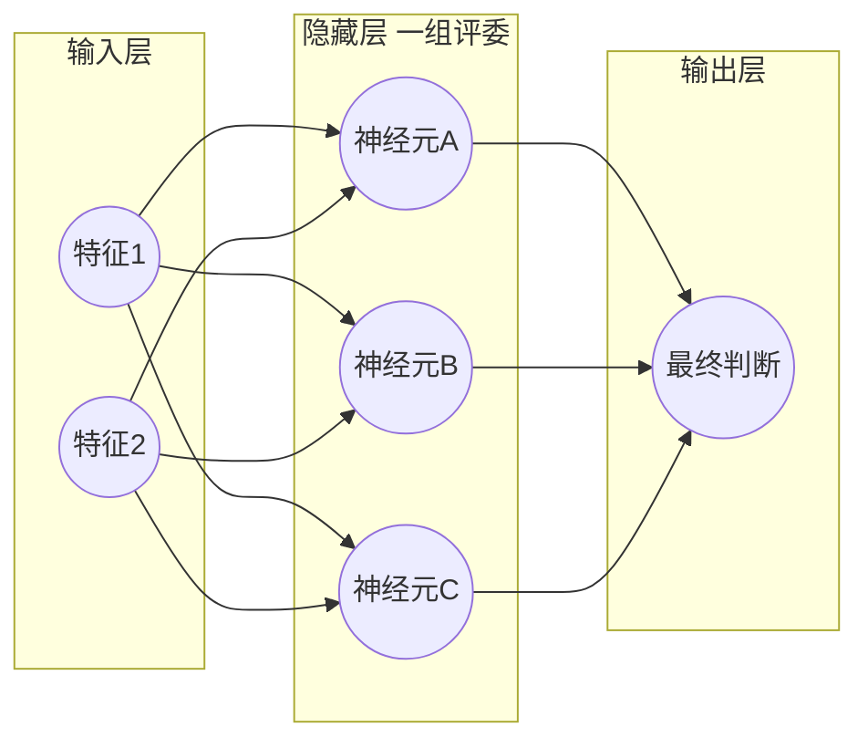
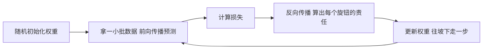

# 第 4 章 神经网络是怎样炼成的

> **本章你会弄明白:**
> 人工神经元是怎么"投票"的?为什么单个神经元学不会某些简单的事,叠起来就行?一个神经网络从头到尾训练一遍,到底发生了什么?你还可以在网页里亲手训练一个。

---

## 4.1 为什么要专门用一章来讲神经网络

后面几章里,机器会看、会听、会说,背后几乎都站着同一个"主角":**神经网络**。图像识别里的卷积网络、语音识别里的端到端模型、ChatGPT 里的 Transformer,说到底都是神经网络的"变种"。

所以,在讲具体本领之前,我们先把这个主角认认真真地认识一遍。放心,依然没有公式,只有比喻和可以动手玩的小实验。

## 4.2 从大脑得到的启发

你的大脑里大约有 **800 多亿个神经元**。每个神经元很简单:从许多"邻居"那里接收信号,如果信号加起来足够强,它就"兴奋"一下,把信号传给下一批神经元。单个神经元很笨,可是几百亿个连在一起,就产生了思考、记忆和情感。

1943 年,两位科学家(麦卡洛克和皮茨)就提出了一个大胆的想法:**能不能用一个极简的数学小零件,模仿神经元?** 1958 年,心理学家罗森布拉特造出了第一台能"学习"的神经网络机器,叫做**感知机**。当时的媒体兴奋地报道:这种机器将来能走路、说话、甚至有意识。(是的,这样的"过度乐观"在 AI 史上反复出现。)

## 4.3 一个会"投票"的小零件

我们把人工神经元想象成一个**投票决定要不要出门的人**:

> 周末你要不要出去玩?你会考虑几个因素:
> - 天气好吗?(很重要,权重大)
> - 有朋友约你吗?(重要)
> - 作业写完了吗?(有点重要)
> - 外面有多堵?(负面因素,权重是负的)
>
> 每个因素给一个"**重要程度**"(权重),把它们**加权求和**,再加上一个"天生想不想出门"的偏好(叫**偏置**)。如果总分超过 0,就出门。

人工神经元做的事情**完全一样**:

1. 接收若干个输入(每个输入有一个权重)。
2. **加权求和**,再加上偏置。
3. 根据总分做出判断(超过门槛就"激活")。

其中**权重和偏置就是模型的"旋钮"**。训练,就是自动拧这些旋钮。

下面这个小实验,让你亲手拧一拧。把权重和偏置的滑块拖一拖,看分界线怎么变;再点"让机器自己学",看看机器是怎么把旋钮拧到合适位置的。

<NeuronDemo />

你会发现:**单个神经元的本事,就是在平面上画一条直线**,把两类东西分开。如果两类东西是"线性可分"的(中间能画一条直线分开),它学得又快又好。

## 4.4 第一次寒冬:一个"异或"问题

可是,如果两类东西没法用一条直线分开呢?

看这个小游戏,叫**异或**(XOR):

- 一个同学**和**另一个同学**只有一个**来的时候,开班会(来的人数恰好是 1)。
- 两个人都来了、或者都没来,就不开。

把它画成平面上的四个点:

```
  1 |  开会     不开
    |
  0 |  不开     开会
    +------------------
       0        1
```

对角线上的两个点属于同一类。你试试看,能不能画**一条直线**把"开会"和"不开"分开?——**不可能**。

1969 年,著名学者明斯基和派珀特在一本书里指出了这一点:**单层的感知机连这么简单的"异或"都学不会**。这一下子给神经网络研究浇了一盆冷水,很多研究经费被转到了别的方向,这就是第一次"AI 寒冬"的原因之一(第 1 章提过)。

后来人们才想明白:**一个神经元画一条直线,那就用好几个神经元,分层叠起来!**

## 4.5 把神经元叠起来:神经网络

想象这样一支"评审团":

- **第一层**有好几位评委,每个评委用自己的标准(画自己的一条直线)做一个简单的判断。
- **第二层**的评委,不直接看原始材料,而是看**第一层评委们的判断**,综合出更高级的结论。
- 最后一层给出最终答案。

在"异或"问题里,第一层的两位评委分别画两条斜线,第二层的评委再把它们组合一下,就能圈出"对角线上的两块区域"。**多条直线组合起来,就能画出弯弯曲曲的复杂边界**。



- **输入层**:接收原始数据(比如图片的像素)。
- **隐藏层**:中间的各层,负责把信息一层层加工。"隐藏"只是因为我们看不到它们该学什么,是网络自己决定的。
- **输出层**:给出答案(比如"猫 92%")。

层数很多的网络叫**深度神经网络**,用它做学习就叫**深度学习**。"深"指的就是层数多。

### 一个小问题:为什么每层之后要"弯一下"?

如果每个神经元只做"加权求和",那么叠再多层,整个网络也只相当于一个神经元(因为"直线再叠直线"仍然是直线)。所以,每个神经元算完总分之后,还会做一个**非线性变换**,叫**激活函数**,把总分"弯"一下。

最常见的一种叫 **ReLU**,规则简单到不可思议:**总分是负的就变成 0,是正的就原样保留**。就这么一个"折一下"的小动作,让网络有了画曲线的能力。你可以想象成:用很多条小折线,拼出一条平滑的曲线。

## 4.6 一个神经网络是怎么被训练出来的

现在我们把整个训练过程完整地走一遍。想象你要训练一个网络,判断一张图是猫还是狗。

### 第 1 步:初始化——随机拧旋钮

一开始,几百万个权重全部是**随机的小数**。这时候的网络就是个"瞎子",输出完全是乱猜,"猫 51%,狗 49%"。

### 第 2 步:前向传播——做一次预测

拿一张图(已知答案是猫),让数据从输入层一层层流向输出层,得到一个预测,比如"猫 30%,狗 70%"。这个过程叫**前向传播**。

### 第 3 步:算损失——看看错得多离谱

预测是"猫 30%",而正确答案是"猫 100%",差得远,**损失**就很大。如果预测"猫 95%",损失就很小。

### 第 4 步:反向传播——追查"谁的责任"

网络里有成千上万个旋钮,到底该调哪一个?

**反向传播**的办法,像一个**工厂追查次品的责任**:

> 成品出了问题。老板从最后一道工序开始问:"你对这个问题有多大责任?"然后再问上一道工序:"那你呢?"……一路往回追,每道工序都得到一个自己的"责任大小",并据此改进。

数学上,这是靠一个叫"链式法则"的工具,从输出端往输入端一层层把"误差该怪谁"算清楚。你不必懂细节,只需记住它的**效果**:**每一个旋钮,都得到一个"你该往哪边拧、拧多少"的建议**。

### 第 5 步:更新旋钮——往坡下走一小步

每个旋钮按建议,朝着让损失变小的方向,拧一点点。这"一点点"有多大,由**学习率**决定(第 2 章的"小球下山"你玩过了:太小太慢,太大会震荡)。

### 第 6 步:重复——几百万次

换一批图片,重复第 2~5 步,几万次、几十万次、几百万次。每看完一遍全部训练数据,叫一个 **epoch(轮)**。每次实际处理的一小批图片,叫一个 **batch(批)**,因为一次处理全部数据太慢,所以每次拿一小批图,估计一下"大概该往哪边拧",然后就拧了——这个方法叫**随机梯度下降**。



### 你会看到什么?

训练过程中,损失会一点一点下降:最开始降得快,后来越来越慢,最后停在一个比较低的位置附近。这条曲线叫做**损失曲线**,看它是训练时最重要的"体检报告"之一。

## 4.7 亲手训练一个:神经网络游乐场

下面这个演示,是在你的浏览器里**真实训练**一个小神经网络(不是动画,是真的在做刚才说的前向传播、反向传播、更新权重)。

试试这样玩:

1. 选择**"圆环"**数据集:蓝点在中间,橙点在外面一圈。把隐藏层数设为 **0**,点"训练"。你会看到,它只能画一条直线,永远分不开(这就是单个神经元的极限)。
2. 把隐藏层改成 **1 层、4 个神经元**,再训练。奇迹发生了:边界变成了一个圈!
3. 换成**"螺旋"**数据集:这是个很难的题。1 层不够,试试 2 层、每层 6~8 个神经元,再把学习率调一调。
4. 玩玩勾选"额外特征":如果你直接把 x² 和 y² 这样的"手工特征"喂给单个神经元,它能解决圆环问题——这就是**第 5 章里说的"手工特征"**的思路;而深层网络的厉害之处,是**这些特征可以自己学出来**。

<NNPlayground />

## 4.8 为什么"深"和"大"会有用

玩过之后,你可能会好奇:为什么更多的层、更多的神经元,就能解决更难的问题?

**一个直观的理解:**

- 一个神经元 = 一条直线(或一个"折痕")。
- 很多神经元 = 很多折痕,拼起来可以逼近**任何形状的曲线**。数学家证明过这个事实,叫做"**万能近似定理**":只要神经元足够多,理论上可以逼近几乎任何函数。
- 而**更深的层数**,让网络可以**一层一层地"抽象"**:第一层看到"边缘",第二层看到"眼睛",第三层看到"猫脸"。这种"逐步抽象"的能力,比"一层里堆很多神经元"要高效得多。

**那为什么直到 2010 年代才爆发呢?** 因为"理论上能做到"和"实际上训练得出来"是两回事。深度网络需要:

1. **大量数据**(互联网才提供得起);
2. **大量算力**(显卡 GPU 刚好擅长这种大规模并行的简单运算);
3. **一些训练技巧**(更好的激活函数、更聪明的初始化、更稳定的优化算法)。

这三样东西,2010 年前后才同时凑齐。

## 4.9 神经网络的"小脾气"

- **黑盒**:几百万个旋钮拧好之后,网络"为什么"给出这个答案,有时很难解释。
- **吃数据**:需要大量例子才能学好。
- **会过拟合**:数据少、网络大,容易死记硬背(第 3 章)。所以训练时要看测试集的表现。
- **对训练数据以外的情况很脆弱**:下一章你会看到"对抗样本"。

---

## 本章小结

- **神经元**:加权求和 + 偏置 + 激活。权重和偏置是旋钮。
- 单个神经元只能画**直线**,连"异或"都学不会(第一次寒冬的原因之一)。
- **分层叠起来**,加上**非线性激活函数**(如 ReLU),就能画出复杂曲线。
- 训练全过程:**初始化 → 前向传播 → 算损失 → 反向传播(追责)→ 更新权重 → 重复**。
- "深度学习"在 2010 年代才爆发,是数据、算力、训练技巧三者凑齐的结果。

## 想一想

1. 在"异或"问题里,你能手工设计两条直线,再用第三条线把它们的结果组合起来吗?
2. 为什么说"每个神经元都做激活"是必要的?如果全部去掉,叠 100 层会怎样?
3. 玩"螺旋"数据集时,你发现了哪些让训练变快或变慢的因素?(层数、神经元数、学习率……)

---

下一章:[让机器会看](ch05.md)
