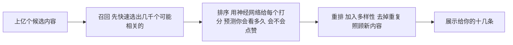
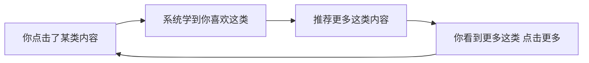

# 第 9 章 AI 为什么这么懂你——推荐系统

> **本章你会弄明白:**
> 视频软件为什么总能"刚好"推给你想看的?"协同过滤"是什么?为什么刷着刷着会陷入"信息茧房"?它和你前面学的"词向量"有什么关系?

---

## 9.1 回到那杯奶茶

还记得序言里的奶茶吗?软件没有偷看你的日记,却猜中了你想喝什么。现在我们已经学了很多,可以把这件事讲透了。

这类系统叫**推荐系统**,它是今天**最贴近你日常生活的 AI**:短视频、电商、音乐、新闻、外卖,背后都有它。它要解决的问题只有一个:

> **在海量的选择里,替你挑出你此刻最可能喜欢的那几个。**

想象一下,一个视频平台里有上亿个视频,你一晚上最多看几十个。如果让你自己从上亿个里挑,你会累死。推荐系统就是那个"替你筛选"的助手。

## 9.2 第一种办法:热门榜

最简单的办法:**大家都爱看的,就推给你**。

- 优点:简单、稳,新用户也能用。
- 缺点:**千人一面**。喜欢冷门科普的你,被迫看着满屏的热门搞笑视频。

## 9.3 第二种办法:看内容相似

你刚看了一个"讲黑洞的科普视频",系统就去找**内容相似**的:标签是"天文""科普"的视频。

这需要给每个视频打上"标签",或者用 AI 去**理解**视频的内容(还记得吗?第 5 章的"看"、第 6 章的"听"、第 7 章的"读",都可以用来理解内容)。

- 优点:不依赖别人的数据,新视频也能被推荐。
- 缺点:**越推越窄**,你只会看到"和你看过的一样"的东西,很难有惊喜。

## 9.4 第三种办法:找"口味相似的人"——协同过滤

有一种聪明得多的办法,**根本不需要理解内容**,甚至不需要知道奶茶是什么味道:

> 你和小 A 最近都给"杨枝甘露"打了 5 分,给"柠檬茶"打了 2 分,口味很像。小 A 还喝过"芒果冰沙"并打了 5 分,而你没喝过。那么——**你也很可能喜欢"芒果冰沙"**。

这就是**协同过滤**的核心思想:**"物以类聚,人以群分"**。

步骤只有三步:

1. **找相似的人**:计算你和其他用户"口味"的相似度。
2. **看他们喜欢什么**:相似的人喜欢、而你还没试过的东西。
3. **按相似度加权预测**:越像你的人,他的意见分量越重。

下面这个小程序,里面有 8 位"虚拟用户"和 8 款奶茶。你给你喝过的奶茶打分,系统就会算出"谁和你最像",并推荐你没喝过的:

<RecommenderDemo />

试试这些玩法:

- 只给两三款打分,看看推荐准不准。再多打几款,推荐有什么变化?
- 故意只给"甜的"打高分、"清爽的"打低分,看看系统会不会把你"归"到某个群体里。
- 想一想:如果你只给一款奶茶打了分,系统能可靠地推荐吗?为什么?(这个问题叫**冷启动**。)

## 9.5 更进一步:给用户和物品都找一张"口味地图"

协同过滤有个问题:用户和物品都有几百万、几千万个,**每对"用户—物品"都要算相似度,太慢了**。而且大多数人只看过极小一部分内容,表格里绝大部分格子都是空的。

于是研究者想出一个**特别漂亮**的办法,你一定很熟悉——还记得第 7 章的**词向量**吗?

> **给每个用户、每个物品,都分配一个"坐标"(一串数字),放在同一张"口味地图"上。**
>
> 比如,地图有几个维度:"甜度偏好""清爽偏好""奶香偏好""价格敏感度"……
> - 一个爱甜的用户,他的坐标在"甜度"这个方向上很高。
> - 一杯很甜的奶茶,它的坐标在"甜度"方向上也很高。
> - **预测"某用户会不会喜欢某物品",只需要看他们在地图上靠得近不近。**

最神奇的是:**这张地图的维度,不是人定义的,而是机器从大量"用户—物品"的行为里自己学出来的。** 它可能学到了"甜度""价格敏感"这样我们能理解的维度,也可能学到一些我们根本说不清含义的维度。

这种思路叫做**矩阵分解**或**嵌入(embedding)**。"嵌入"是整个现代 AI 里最重要的思想之一:

> **把任何东西——词、用户、商品、图片、声音——都变成一串数字(向量),放进同一个空间里。"相近"就是"相似"。**

大模型里,每个 token 也是这样变成向量的。你在第 7 章玩过的"词向量地图",和这里的"口味地图",本质上是同一个想法。

## 9.6 现实中的推荐系统:不只是"猜你喜欢"

真实的推荐系统要复杂得多,通常是一个**流水线**:

- **召回**:先用快而粗的方法(比如嵌入向量的"近邻搜索")从海量内容里挑出几千个候选。
- **排序**:再用精细的神经网络,对每个候选预测"你会看多久""会不会点赞""会不会转发",综合打分。
- **重排**:最后调整一下顺序,比如避免连续推荐同一类、给新作者一点机会。

模型从哪里学到你的喜好?**从你的每一次行为**:点击了什么、看了多久、划走得多快、有没有点赞、有没有重复观看。这些行为就是模型的"练习册"。你的每一次停留,都是在给 AI 打分。

## 9.7 推荐系统的"副作用"

推荐系统让生活更方便,也带来了一些值得思考的问题。

### 信息茧房

系统的目标是"让你多看一会儿"。你喜欢看什么,它就推什么,你看得越多,它推得越准——**慢慢地,你看到的世界越来越窄**。这就叫"信息茧房":你像蚕一样,被自己的喜好织成的茧包住了,听到的都是自己爱听的、同意自己观点的声音。

这是一个**反馈循环**:模型的输出,会影响你的行为,你的行为又变成模型下一轮的训练数据。

### 目标错位

还记得第 8 章强化学习里"赛艇刷分"的故事吗?如果系统的目标是"最大化你的观看时长",它就可能倾向于推荐**最抓人眼球、最让人停不下来**的内容,而这些未必是**对你最好**的内容。**AI 只会朝着你给它的目标使劲,所以"目标怎么设"很重要。**

### 隐私

推荐系统需要大量你的行为数据。这些数据怎么被收集、怎么被保护,也是一个重要话题(第 14 章会再聊)。

### 你可以做什么?

- 有意识地**主动搜索**一些你平时不会看的话题,给系统"打破常规"的信号。
- 关注**不同观点**的来源,而不只是被动接受推送。
- 留意自己的使用时间,问自己一句:"我是真的想看,还是只是停不下来?"
- 学会使用平台提供的"不感兴趣""重置推荐"等功能。

## 9.8 推荐系统和大模型的关系

你会问:推荐系统和 ChatGPT 之类的大模型,是同一回事吗?

不完全是,但越来越接近:

- 它们都是用**神经网络**,从**大量数据**里学规律。
- 它们都用到了**嵌入**:把东西变成向量。
- 它们都用**大规模训练**,模型越大、数据越多,效果越好。
- 不同的是:传统推荐系统是"给你**挑选**现有的内容",大模型是"为你**生成**新的内容"。

今天,两者正在融合:比如用大模型来**理解内容**、**解释推荐理由**,甚至根据你的需要**生成个性化的内容**。

---

## 本章小结

- **推荐系统**:在海量内容里,替你挑出你可能喜欢的。
- 三种基本思路:**热门榜**(千人一面)、**内容相似**(越推越窄)、**协同过滤**(找口味相似的人)。
- **嵌入**:把用户和物品都放进同一张"口味地图",靠"距离"判断匹配度,和词向量是同一思想。
- 真实系统是**召回 → 排序 → 重排**的流水线。
- 副作用:**信息茧房**、**目标错位**、**隐私**。我们可以主动"打破常规"来平衡。

## 想一想

1. 回想你最近刷过的一类推荐内容,你觉得系统是用了"热门""内容相似"还是"协同过滤"?为什么?
2. 如果你是一款学习软件的设计者,你会让推荐系统优化什么目标?"用户学习时长"合适吗?
3. 一个新用户刚注册,系统什么都不了解(冷启动),你会怎么设计开头的推荐?

---

下一章:[Transformer 与大模型](ch10.md)
