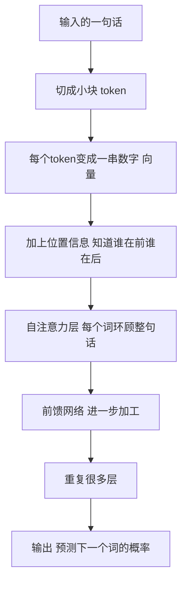

# 第 10 章 Transformer 与大模型的诞生

> **本章你会弄明白:**
> "注意力"是什么意思?为什么 2017 年的一篇论文,改变了整个 AI 的走向?大模型到底"大"在哪里?它是怎样一个词一个词"蹦"出话来的?

---

## 10.1 一道让机器头疼的阅读题

请读下面两句话,回答问题。

> **句子 A**:小猫没有跳上桌子,因为**它**太累了。
> **句子 B**:小猫没有跳上桌子,因为**它**太高了。

两句话几乎一样,只有最后一个词不同。问:这两句里的"它"分别指什么?

你立刻就知道:A 里的"它"是**小猫**(累的是猫),B 里的"它"是**桌子**(高的是桌子)。

你是怎么做到的?你读到"它"的时候,脑子里自动**回头看**了前面的话,并且根据"累"或"高"这样的线索,判断该和谁挂钩。

可是对于上一章的 RNN、LSTM 来说,这件事很难:它们是**一个词一个词顺着读下去**,信息要经过很多步才能传到后面,一路上难免被稀释和遗忘。

人们迫切地需要一种新办法:**让每个词可以直接"看到"整句话里其他所有词,并且能判断"哪些词对我最重要"。**

## 10.2 注意力:给文字涂上荧光笔

做阅读理解题时,你是不是常常拿一支荧光笔,把和问题有关的句子标出来?

**注意力机制**(Attention)的思想,和荧光笔很像:

> 在处理每一个词时,模型会给整句话里的每个词打一个"**关注度**"分数,分数高的词,多看一眼;分数低的词,少看一眼。

以句子 A 为例,当模型处理"它"这个词时,注意力可能是这样分配的:

| 词 | 关注度 |
|---|---|
| 小猫 | **高** |
| 桌子 | 中 |
| 因为 | 低 |
| 太累了 | **高** |
| …… | 低 |

于是,模型在理解"它"时,会重点参考"小猫"和"太累了",这就能推出"它"指的是小猫。

而在句子 B 里,当"它"碰到"太高了"时,注意力会更多落在"桌子"上。

### 亲手看一看"注意力"

下面的演示里,点击任意一个词,就能看到它在"回头看"句子里的哪些词。**注意:这里的注意力权重是我们为了讲解手工设计的示意,不是真实模型的输出**,但它展示了真实模型学到的那类现象。

试试:选第一句,点"它";再选第二句,点"它"。同一个"它",关注点是不是变了?

<AttentionDemo />

**这些关注度分数是怎么来的?** 是通过训练学出来的。模型读了海量的文本,慢慢学会:"在什么情况下,应该重点看哪些词。"

**注意力的好处:**

1. **不再受距离限制**:不管两个词隔多远,都能直接建立联系。
2. **关注重点**:不是平均地对待每个词,而是自动抓重点。

其实,注意力机制最早是在上一章 seq2seq 翻译中被引入的:翻译到某个词时,"回头看"原句里哪个词最相关,这样就不必把整句话压成一个摘要。它让翻译质量大大提升。

## 10.3 Transformer:一篇改变世界的论文

2017 年,谷歌的几位研究者发表了一篇论文,标题大胆得有些挑衅:

> **《Attention Is All You Need》(注意力就是你所需要的一切)**

他们的想法是:**既然注意力这么好用,为什么不干脆把 RNN 彻底扔掉,只用注意力来搭一个网络呢?** 这个新结构,叫做 **Transformer**。

它为什么这么重要?有两个原因:

### 原因一:能"并行"读,训练飞快

RNN 必须一个词一个词按顺序读,第 5 个词要等第 4 个词处理完才行。这就像**一个人逐页读一本书**。

Transformer 则可以**同时处理整句话里的所有词**。这就像**把书的每一页同时分给一百个人,大家同时读,再互相交流**。这个特点,和 GPU 擅长大量同时计算的特点,完美匹配。训练速度大大提升,**使得训练非常巨大的模型成为可能**。

### 原因二:自注意力让每个词都能"环顾四周"

在 Transformer 里,每个词都会和句子里**所有其他词**(包括自己)进行"注意力"计算,更新自己的意思。这叫**自注意力**。

一个词在经过很多层自注意力之后,它的"含义"就越来越丰富,吸收了整个上下文的信息。

打个比方:

> 一个新同学转学来到班级。第一层,他只知道自己的名字;经过一轮和周围同学的交流,他知道了班里的氛围;又经过一轮,他知道了谁和谁是好朋友……层数越多,他对整个班级的理解越深入。

### 一张简化的流程图

几个要点:

- **token(词元)**:模型处理文字的最小单位。不一定是完整的词,可能是一个字、一个词、甚至半个词。比如英文 "unbelievable" 可能被切成 "un" + "believ" + "able"。
- **位置信息**:因为所有词是同时处理的,模型本身不知道谁在前谁在后,所以要额外给每个词标上"座位号"。
- **多层**:这样的"自注意力+加工"模块会叠很多层,几十层甚至上百层。

### 亲手试试:文字是怎么被切成 token 的

下面是一个**简化版的切词器**。输入任意文字,看看它被切成了哪些 token。真实的大模型用的是从数据里自动学出来的词表(BPE 之类的算法),但思想一样:**常见的词整个保留,罕见的词拆成小块。**

<TokenizerDemo />

Transformer 就像一块"万能积木":最早用来做翻译,后来发现不仅能处理文字,**还能处理图像、声音、视频、蛋白质序列……** 几乎是什么都可以。可以说,**它成了今天几乎所有大模型的共同骨架。**

## 10.4 先读万卷书,再学本事:预训练加微调

Transformer 提供了强大的"大脑结构"。接下来的问题是:怎么训练它?

传统做法是:针对每个任务(翻译、分类、问答……),专门收集标注数据,从零训练一个模型。这样,每个任务都要从头开始,成本很高。

2018 年前后,研究者们转变了思路,提出一套新的"学习路线":

### 第一步:预训练——读万卷书

让模型读**海量的、没有标注的文本**(网页、书籍、百科、代码……),用**自监督学习**的办法:

- 一种做法:**把句子里的某个词盖住,让模型猜**(完形填空)。
- 另一种做法:**给出前面的话,让模型预测下一个词**(接龙)。

这个过程没有人来标注,文字本身就是答案。模型因此学会了语法、常识、事实,甚至一些推理的"套路"。

### 第二步:微调——学专业技能

预训练好的模型已经有了"通识教育"。然后,拿少量任务相关的数据,比如几千条客服对话,让它"专项训练"一下,就能很快胜任某项具体任务。

就像:**先读完十二年基础教育,再用一年学一门专业**,比从零开始快得多、好得多。

这个"**预训练 + 微调**"的范式,极大地提高了效率,也催生了真正意义上的"基础模型"(Foundation Model):**一个模型打底,到处使用。**

## 10.5 "大"在哪里?——规模的魔力

现在,我们来回答标题里的问题:**大模型的"大",到底指什么?**

### 一、参数多

还记得吗?参数就是模型里的"旋钮"。

| 模型 | 参数量(大致) |
|---|---|
| 早期的神经网络(LeNet,1990 年代) | 约几万 |
| AlexNet(2012) | 约 6000 万 |
| 最早的 GPT(2018) | 约 1 亿 |
| GPT-2(2019) | 约 15 亿 |
| GPT-3(2020) | 约 1750 亿 |
| 如今一些最先进的模型 | 数千亿到更大规模(具体数字多数未公开) |

从几万到几千亿,**增长了千万倍**。

### 二、数据多

大模型"阅读"的文字,是几万亿个 token 的量级,相当于**几百万、上千万本书**,人类一辈子都读不完。

### 三、算力多

训练这样的模型,需要成千上万块高性能显卡,连续运转数周甚至数月,耗电量惊人,成本以百万、千万甚至上亿美元计。

### 规模定律:越大越好,而且很有规律

2020 年前后,研究者们发现了一个令人惊讶的规律,叫做**规模定律**(Scaling Laws):

> **只要同时增加模型规模、数据量和算力,模型的表现就会以一种可预测的方式、持续地变好。**

这意味着,研究者们可以像"画一条趋势线"那样,预测"如果我把模型再放大 10 倍,效果大概会提高多少"。这给了整个行业巨大的信心:**往大了做,似乎总能得到更强的结果。**

当然,"越大越好"并不是无限的。后来人们也逐渐意识到:**数据质量、训练方法同样重要**,模型不能只靠"堆料"。

### 一个意想不到的现象:涌现

更有意思的是,当模型规模达到一定程度时,会突然出现一些**小模型完全不具备的能力**,比如:

- 做多位数的加法,
- 一步步推理解决应用题,
- 听懂并执行从未见过的指令。

就像水加热到 100℃ 才会突然沸腾,这种现象被称为"**涌现**"。不过,涌现到底是真的"突变",还是和我们的测量方式有关,学术界仍有争论。

## 10.6 一句话是怎么被"蹦"出来的?

我们来用一个具体的例子,看看大模型是怎样工作的。假设你对大模型说:

> **"请用一句话介绍猫。"**

### 第 1 步:切成 token

句子被切成若干小块,比如:`请` `用` `一句话` `介绍` `猫` `。`
每个 token 对应词表里的一个编号,再变成一串数字(向量)。

### 第 2 步:一层一层处理

这些向量输入到 Transformer 里,经过几十层"自注意力 + 加工"。每一层,每个 token 都在"环顾四周",更新自己的理解。到最后一层,**最后一个位置**的向量里,汇集了对整句话的理解。

### 第 3 步:预测下一个 token

模型根据这个向量,给整个词表里的每个 token 打一个概率:

| 候选 token | 概率 |
|---|---|
| 猫 | 35% |
| 是 | 20% |
| 一种 | 12% |
| …… | …… |

按概率"抽签",比如抽到"猫"。

### 第 4 步:把新词加进去,继续预测

"请用一句话介绍猫。猫" → 预测下一个 → "是" → 再加上去 → "一种" → "常见" → "的" → "宠物" → ……

直到模型预测出一个特殊的"**结束**"标记为止。

**所以,当你看到聊天机器人一个字一个字"蹦"出来,并不是为了营造效果,而是因为它真的就是一个 token 一个 token 地生成出来的。**

### 亲手试试:逐词生成

下面用一张**手写的小概率表**来模拟大模型"一个 token 一个 token 蹦字"的过程(概率是为讲解设计的,不是真实模型的输出)。你可以:

- 点击任意一个**候选词**,亲自"替模型选";
- 点"按概率抽样一步",看看运气;
- 调节**温度**,看概率分布怎样"变平"或"变尖";
- 每次生成完,点"重置",再来一次——你会发现**同一个开头,可以走向不同的结尾**。

<StepGenDemo />

### 一个很重要的概念:上下文窗口

模型能够同时"看到"的内容有一个长度上限,叫做**上下文窗口**。你和机器人聊天的每一轮对话,都会被连同之前的内容,一起拼起来输给模型。如果聊得太长、超出了窗口,最早的内容就会被"挤出去",模型就"忘了"。

早期模型的窗口只有几千个 token,相当于几页纸;现在很多模型能达到几十万甚至更长,相当于一整本书。

---

## 10.7 多头注意力:一个人看不过来,就多派几个人

一个"注意力"只能给每个词打一套"关注度"。可是一句话里,词与词的关系有很多种:

- 语法关系(主语—谓语);
- 指代关系("它"指谁);
- 距离关系(相邻的词常常相关);
- 语义关系("医生"和"病人")……

所以 Transformer 里不是只有一个"注意力",而是同时有**许多个**,叫做**多头注意力**。每个"头"各自关注不同类型的关系,最后把大家的发现汇总起来。就像一群评审,有人看语法、有人看逻辑、有人看用词,综合后给出整体判断。

研究者拆开训练好的模型看时,发现有些"头"确实形成了可以解释的分工:有的专门找前一个词,有的专门管代词指代,有的盯着句子结尾的标点。**这些分工不是人设计的,是训练中自己长出来的。**

## 10.8 模型的"知识"存在哪里?

有人好奇:大模型"知道"巴黎是法国首都,这个事实存在哪儿?

答案是:**它不像百科全书那样,一条一条存放在某个位置,而是"分散"地编码在几千亿个参数里。** 训练过程中,每读到"巴黎是法国的首都"这样的句子,相关的参数就被微微调整一点点,让模型下次更容易接出"法国"。读过成千上万遍类似的表述之后,这种关联就变得稳固。

这带来两个后果:

1. **好处**:它不需要精确匹配原文,换一种问法("法国的首都叫什么")也能答对。
2. **坏处**:它很难"精确地删掉"或"更新"某条知识;如果训练数据里有错误,它也会"学"进去;对不常出现的事实,记忆很模糊,容易出错(这和第 11 章的"幻觉"有关)。

## 10.9 训练与使用:大模型的"一生"成本

| | 训练(读书阶段) | 推理(回答阶段) |
|---|---|---|
| 做什么 | 反复预测、算损失、更新数百亿参数 | 固定参数,只做前向传播,逐个生成 token |
| 算力需求 | 极大:成千上万块显卡连续跑数周到数月 | 每次较小,但用户多了总量巨大 |
| 花费 | 一次性的大额投入 | 持续的运行成本(和使用量成正比) |
| 能不能出错重来 | 代价很大,所以需要精心设计与反复小规模验证 | 可随时重新生成 |

这也是为什么人们热衷于研究:

- **更小但更强的模型**:通过更好的数据与方法,让几十亿参数的模型也能表现出色,可以在手机、电脑上运行。
- **量化**:把参数的精度降低(比如每个参数用更少的比特保存),让模型变"瘦",速度更快、占内存更少,效果略有损失。
- **蒸馏**:让"大老师模型"教"小学生模型",把大模型的能力"浓缩"进小模型。

## 本章小结

- **注意力机制**:给每个词打"关注度"分数,像荧光笔一样抓重点。
- **Transformer(2017)**:只靠注意力搭建,可**并行**训练,每个词能直接"环顾"全句。
- **预训练 + 微调**:先用海量文本"读万卷书"(自监督),再针对任务"学专业"。
- 大模型的"大":**参数多、数据多、算力多**。**规模定律**表明规模越大效果越好,并出现了"涌现"现象。
- 生成文字的过程:**切成 token → Transformer 处理 → 预测下一个 token → 加入后继续**。
- **上下文窗口**限定了模型一次能"看"多少内容。

## 想一想

1. 请你想一个"它""这个""那里"之类的代词指代不清的句子,感受一下人类是怎么"回头看"的。
2. 为什么 Transformer 能"并行"处理,这对训练大模型为什么特别关键?
3. 如果让你设计一个考试,测试一个模型是不是出现了"涌现"能力,你会怎么设计?

---

下一章:[大模型的前世今生与 ChatGPT 是怎样炼成的](ch11.md)
