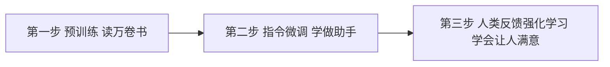
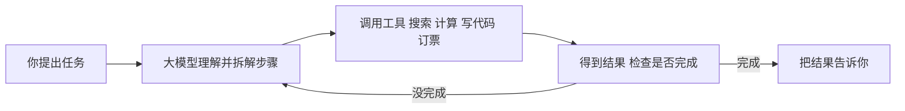

# 第 11 章 大模型的前世今生与 ChatGPT 是怎样炼成的

> **本章你会弄明白:**
> 大模型是怎样一步步走到今天的?ChatGPT 这样的"会聊天的助手",是怎么从一个"只会接龙"的模型变出来的?它为什么会"一本正经地胡说八道"?"看、听、说、做"又是怎样汇聚到一起的?

---

## 11.1 一张时间线

我们先把前面几章讲到的线索,汇成一张大致的时间线:

下面我们挑几个关键节点,讲讲其中的故事。

## 11.2 两条路:BERT 与 GPT

Transformer 出来之后,很快分出两个"门派"。

### BERT:善于"理解"的完形填空高手

2018 年,谷歌发布了 **BERT**。它的训练方式是:**随机盖住句子里的一些词,让模型根据上下文(前后都能看)去猜。**

> 例如:"今天 [遮住] 很好,我们去公园放风筝。" → 模型猜"天气"。

BERT 特别擅长**理解**类的任务:判断句子的意思、情感倾向、在文章里找答案。当时,搜索引擎等不少产品都用上了它。

### GPT:善于"续写"的接龙高手

OpenAI 发布的 **GPT**(Generative Pre-trained Transformer,生成式预训练 Transformer),走的则是另一条路:**只能看前面的词,预测下一个词**,也就是我们前面讲的"接龙"。

这种模型天生擅长**生成**:给个开头,就能写下去。

- **GPT-1(2018)**:证明了"预训练 + 微调"在语言上很管用。
- **GPT-2(2019)**:参数十几亿,能写出相当连贯的段落。OpenAI 起初因为担心被滥用,没有一次性公开完整模型,引发了不小讨论。
- **GPT-3(2020)**:参数约 1750 亿,有了一个很重要的新发现:**不需要重新训练,只要在提示里给它几个例子,它就能照着做**。比如:

> 英文:cat → 中文:猫
> 英文:dog → 中文:狗
> 英文:bird → 中文:

模型自然就会接上"鸟"。这叫**少样本学习**(Few-shot learning),也叫"**上下文学习**"。人们意识到:**只靠"预测下一个词",这个超大模型似乎学到了一种很通用的"现学现用"本领。**

后来,GPT 这条"生成路线"成为主流,大部分我们今天用的聊天模型,都属于这个家族的思路。

## 11.3 可是,GPT-3 还不是 ChatGPT

GPT-3 虽然强大,但用起来其实有点"别扭"。

你对它说:"**请解释什么是黑洞。**"它可能这样接下去:

> "请解释什么是黑洞。请解释什么是白洞。请解释什么是虫洞。……"

它没有"回答"你,而是在**续写**你的话——因为它被训练成"预测网络文字中下一个词",而互联网上,一个问题后面,经常真的跟着另一个问题!

我们需要的是一个**听得懂指令、愿意帮忙、说话得体**的"助手",而不只是一个"接龙机器"。

怎样把接龙机器改造成助手?这就是 **ChatGPT 的"三步炼成法"**。

## 11.4 ChatGPT 的三步炼成法

### 第一步:预训练——读万卷书(成为"博学的接龙高手")

和前面所说的一样:拿互联网上的海量文字,训练模型预测下一个词。这一步花费最大,耗时最久。

产出的是一个**基础模型**:知识渊博,但不"听话"。就像一个读了很多书、但没学过怎么跟人交流的学者。

### 第二步:指令微调——学做助手(教它"一问一答"的格式)

人们找来一批人,专门编写大量**"指令—理想回答"**的例子:

> 指令:请用简单的话解释什么是黑洞。
> 回答:黑洞是宇宙中一种引力极强的天体,强到连光都无法逃脱……

让模型学习这些例子,慢慢习惯:**看到问题,就应该认真地回答,而不是接着再问一个问题。**

经过这一步,模型变得"听得懂人话"。

### 第三步:人类反馈强化学习(RLHF)——学会"让人满意"

光会回答还不够,**回答得好不好**是另一回事。同一个问题,有的回答清楚礼貌,有的啰嗦、冒犯、甚至有害。

怎么让模型学会"什么样的回答更好"?(还记得第 8 章的强化学习吗?奖励又出场了!)

步骤如下:

1. 让模型对同一个问题,生成好几个不同的回答。
2. **请真人给这几个回答排名**:哪个更有用、更诚实、更无害。
3. 用这些排名数据,训练一个"**评分员**"模型(叫奖励模型),让它学会像人一样给回答打分。
4. 然后,用强化学习的办法,让聊天模型**不断调整自己,争取得到评分员给的高分**。

这个过程,就像一个小学生写作文:老师先批改了几篇(排名),培养出了一位"助教评分员",学生再根据助教的评分,不停地修改自己的写作风格。

**这就是为什么今天的聊天机器人,说话通常很有礼貌、有条理、会主动拒绝一些不合适的请求:这些"品味",来自人类的反馈。**

### 一句话总结

> **预训练给了它"知识",指令微调教了它"格式",人类反馈让它学会"得体"。**

2022 年底,基于这套方法的 ChatGPT 上线,短短几个月,用户数量飙升到上亿。这是 AI 第一次以如此直接的方式,走进普通人的生活。

## 11.5 让模型"一步步想":思维链

大模型有个有趣的特点:**让它"想一想"再回答,答案会更准。**

举个例子,一道应用题:

> 小明有 23 个苹果,吃了 7 个,又买了 3 袋,每袋 5 个。现在他有多少个苹果?

如果让模型**直接给出答案**,它可能凭"感觉"蹦出一个数字,有时会错。

但如果我们在提示里加一句"**请一步步思考**",模型就会写成:

> 1. 小明原来有 23 个。
> 2. 吃了 7 个,剩下 23 − 7 = 16 个。
> 3. 买了 3 袋,每袋 5 个,共 15 个。
> 4. 现在有 16 + 15 = 31 个。
> 答案:31。

为什么这样会更准?因为大模型是**一个 token 一个 token 往外生成**的,每写出一步,这一步的结果就成了**下一步的输入**。把推理过程写出来,相当于**给模型提供了"草稿纸"**。

这种"先写出思考过程再回答"的办法,叫做**思维链**(Chain of Thought)。后来,研究者们甚至专门训练模型,让它们在回答之前自己先"想"很多步,这就是近两年出现的"推理模型"的思路。

## 11.6 一本正经地胡说:幻觉

使用大模型的人,迟早会遇到一件令人哭笑不得的事:

你问:"请介绍一下某某教授 2019 年发表的那篇关于量子蚂蚁的论文。"

模型可能文采飞扬地答出标题、期刊、摘要……**可是这篇论文根本不存在!**

这种现象叫做**幻觉**(Hallucination)。

### 为什么会这样?

回想一下大模型的工作原理:**它是在预测"最可能出现的下一个词",而不是在"查证事实"。**

- 它学到的是"文字的规律",包括"论文引用通常长什么样"。
- 当它遇到不知道的内容,按训练目标,它依然会生成一段"**听起来很像真的**"的文字。

它并没有撒谎的意图,它只是在**顺着语言的"惯性"往下写**。这就好比一个学生在考试里遇到不会的题,没有选择空着,而是努力写满答案卷,尽管内容是瞎编的。

### 怎么缓解?

- **检索增强(RAG)**:让模型回答前,先去**搜索资料库**,把找到的资料放在提示里,让它**照着资料回答**,而不是凭记忆。就像开卷考试。
- **联网搜索与工具调用**:数学题调用计算器,时事问题上网搜索。把"不擅长的事"交给专业工具。
- **更好的训练**:训练模型"不知道时要承认不知道"。
- **人类核查**:重要的内容,一定要自己再验证一遍。

> **使用建议:把大模型当成一个"聪明、博学、但偶尔会信口开河的实习生"。它的答案是好的起点,但不是最终的真理。**

## 11.7 看、听、说汇合:多模态

回到我们的主线:机器要会**看、听、说、做**。到了大模型时代,这些能力开始汇合在同一个模型里。这叫**多模态**。

- **看**:你可以给大模型发一张照片,问"这道数学题怎么解?"、"这是什么植物?"。它先用视觉模块把图片变成一串 token,再和文字 token 一起交给 Transformer 处理。
- **听**:你可以直接对它说话,它先用语音识别转写成文字,或者直接"听"音频。
- **说**:它可以用自然的声音回答你。
- **做**:它可以调用各种工具,上网搜索、写并运行代码、操作软件。

**关键的想法是:把一切都变成 token。** 文字是 token,图片切成小块也是 token,声音切成小段也是 token。一旦都变成了同一种"积木",Transformer 就可以统一处理。

### 文生图:从"噪点"里雕刻出画

你可能也用过 AI 画图:输入"一只戴着宇航头盔的橘猫,在月球上喝奶茶",就能出一张图。

大多数这类系统背后用的是**扩散模型**,它的思想很有趣:

> **训练时**:拿一张真实的图片,一步一步往上面**加噪点**,直到变成一片雪花一样的纯噪声。让模型学习"**每一步是怎么加噪点的,怎么反过来去掉一点点噪点**"。
>
> **生成时**:从一片**纯噪声**出发,一步一步**去噪**,在文字描述的指引下,慢慢"雕刻"出一张清晰的图。

就像米开朗基罗说"雕像本来就在石头里,我只是把多余的部分去掉"一样,扩散模型是**从一团混沌里,把画"去"出来**。

后来,类似的技术也被扩展到了**视频生成**:不仅生成一张图,而是生成连贯的一段画面。

## 11.8 AI 智能体:大模型当大脑,工具当手脚

回忆第 8 章的预告。有了大模型,"能办事"的 AI 智能体开始变得现实。

一个典型的过程像这样:

比如你说:"帮我做一个下周数学小测的复习计划。"智能体可能会:

1. 询问你考试范围和可用时间。
2. 调用日历,看看你哪几天有空。
3. 根据考点拆分任务,并生成每日安排。
4. 把计划同步到你的日历里。

这里,**大模型负责理解、规划和决策,工具负责执行**。这是 AI 从"会聊天"迈向"会办事"的关键一步。当然,它也带来新的挑战:如果它自己操作软件、花钱、发消息,就必须有**足够的安全保障**,以及**让人类随时能叫停**的机制。

## 11.9 今天的格局:百花齐放

今天,大模型不再只是个别公司的专利:

- 有**闭源的商业模型**,通过网页或应用提供服务。
- 有**开源/开放权重的模型**(比如 Meta 的 Llama 系列、国内外一些团队发布的开放模型),任何人都可以下载下来研究、改造。
- 国内外的许多科技公司和研究机构,都推出了自己的大模型,在中文理解、代码、推理、多模态等方面不断追赶、互相启发。

> 具体哪个模型最强、有哪些新版本,变化非常快,本书不做排名。重要的是你理解它们**共同的原理**:Transformer + 海量数据预训练 + 指令微调 + 人类反馈 + 工具使用。原理学会了,新产品出来你也能一眼看懂它在做什么。

---

## 11.10 怎么知道一个大模型"好不好"?

每隔一段时间就有新的大模型发布。怎么比较它们?

### 基准测试:给模型出"统一的试卷"

研究者们编了很多"标准考卷",比如:

- 各科的**选择题**(数学、历史、物理、法律……),看模型答对多少;
- **编程题**,让模型写代码,再跑测试用例看对不对;
- **数学应用题**、**逻辑推理题**;
- **阅读理解**、**翻译**。

模型在这些"考卷"上的分数,常被拿来比较高低。

### 人类偏好评测:让真人来打分

还有一种方法:让用户同时看到两个匿名模型对同一问题的回答,**投票选出更好的那个**,再用大量投票算出排名。这更接近真实使用体验。

### 基准测试的局限

分数不是一切,要留一个心眼:

- **刷题**:如果考题(或类似的题目)泄漏进了训练数据,模型就像"提前背了答案"。成绩高,不代表真懂。
- **考卷不等于现实**:现实问题常常模糊、开放、需要结合上下文。
- **只测一部分能力**:创造力、诚实、安全、长期稳定性,不容易用选择题测出来。

> **好的评价习惯:** 不迷信单一排行榜;拿自己真实的问题去测;重要场景下,反复测试并人工检查。

## 11.11 大模型也能"瘦身":蒸馏与量化

既然大模型又贵又慢,能不能让小模型也很聪明?办法之一是**蒸馏**:

> 让一个**大模型(老师)**回答大量问题,再让一个**小模型(学生)**去学这些回答。小模型不是从原始数据里"重新读万卷书",而是**直接向老师学习"怎么答"**。

另一个办法是**量化**:把每个参数保存得"粗糙"一点,模型体积明显缩小。这样一些小型模型就可以在**手机、笔记本**上本地运行,不需要联网,也更保护隐私。

这也是"开源模型"生态很活跃的原因之一:大家可以下载模型,在自己电脑上研究、改造。

## 11.12 提示词里的"小魔法"

了解了大模型"预测下一个词"的本质,你就能理解为什么下面这些做法管用:

| 技巧 | 为什么管用 |
|---|---|
| **给角色**("你是一位耐心的物理老师") | 引导模型进入"像老师那样说话"的文字分布 |
| **给例子**(少样本) | 让模型"照葫芦画瓢",格式更稳定 |
| **要求分步骤思考** | 让它写出"草稿纸",最终答案更准(思维链) |
| **说清楚输出格式** | 缩小它"接下去"的可能范围 |
| **提供资料让它依据** | 减少凭空编造(检索增强的手动版) |
| **让它检查自己的答案** | 第二遍往往能发现第一遍的错误 |

不过要记得:**这些技巧提高的是"概率",不是保证。** 重要的事情,依旧要自己核对。

## 本章小结

- 大模型的演化:**词向量 → seq2seq → Transformer → BERT / GPT → GPT-3 → ChatGPT → 多模态与智能体**。
- **BERT** 擅长理解(完形填空),**GPT** 擅长生成(接龙)。
- 从"接龙机器"到"聊天助手"的三步:**预训练 → 指令微调 → 人类反馈强化学习(RLHF)**。
- **思维链**:让模型写出推理步骤,相当于给它一张"草稿纸"。
- **幻觉**:模型预测"像样的话",而不是查证事实;可用**检索增强、联网、工具、人工核查**缓解。
- **多模态**:把图像、声音都变成 token,统一交给 Transformer 处理。
- **扩散模型**从噪声中"雕刻"出图像。
- **智能体**:大模型当大脑,工具当手脚,从"会聊"到"会做"。

## 想一想

1. 为什么只靠预训练,模型还不能很好地"听话"?请用"学者"与"助手"的比喻来说明。
2. 你用大模型做作业时,怎么验证它给的答案是不是"幻觉"?请列出三种办法。
3. 如果让 AI 智能体帮你自动订外卖、付款,你希望设置哪些"安全开关"?

---

下一章:[AI 与科学](ch12.md)
