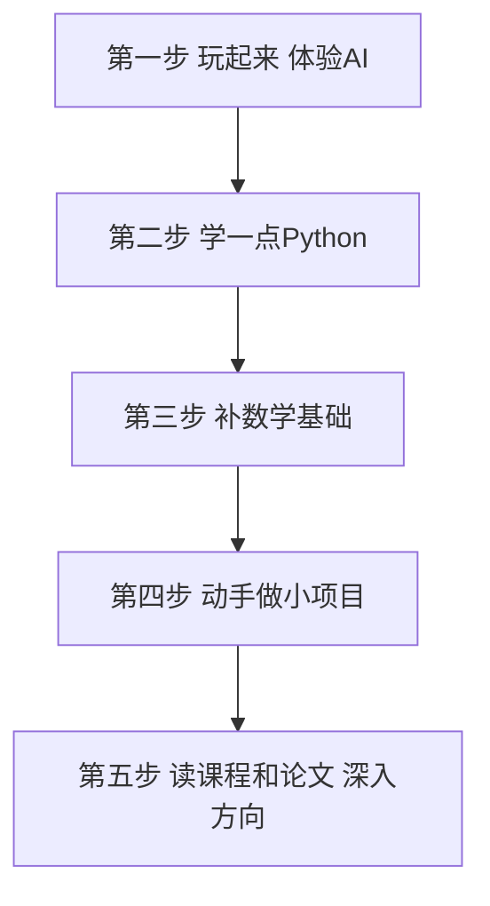

# 第 14 章 未来、风险与你的 AI 学习路线

> **本章你会弄明白:**
> AI 现在还有哪些做不到、做不好的地方?我们应该怎样和 AI 相处?如果你想进一步学习,从哪里开始最合适?

---

## 14.1 先泼一盆冷水:AI 的局限

经过前面九章,你可能觉得 AI 无所不能。现在,让我们诚实地看看它的短板。

### 一、会"胡说"(幻觉)

上一章讲过:大模型是在预测"像样的话",而不是在查证事实。**越是冷门、越是需要精确的信息(日期、数字、引用、人名),越要核查。**

### 二、不一定"懂"

AI 擅长从大量数据里找到**模式**。但很多时候,它缺少人类拥有的**常识**和**因果理解**。

> 一个典型的"小测验":"我把一个杯子倒扣在桌子上,然后把桌子翻转过来,杯子里的水会怎么样?"
> 对人来说,这需要想象物理过程。AI 在简单版本上常常能答对,可一旦题目被改得稍微绕一点,它就容易出错。

### 三、会带有偏见

AI 的知识来自人类写下的文字、拍下的图片。**人类社会里存在的偏见,会被模型"学"进去。**

- 如果招聘数据里,历史上某个岗位大多数是男性,模型可能"学到"男性更适合这个岗位。
- 如果图片数据里某类人群很少,模型对这类人群的识别效果就会更差。

所以,AI 不是天然"客观公正"的,**数据里的偏见,会变成模型的偏见**。研究者们正在努力用更好的数据和方法减少偏见,但这仍然是一项长期挑战。

### 四、隐私与安全

- 你输入给 AI 的内容,可能会被保存、分析,所以**不要随便输入身份证号、密码、家庭住址、他人的隐私**。
- **深度伪造**:AI 能生成以假乱真的图片、声音、视频。有人用它造谣、诈骗。**"眼见为实""耳听为真"在 AI 时代需要打个问号。** 遇到涉及钱的请求,尤其是"熟人"突然发来语音或视频要钱,一定要通过其他渠道再确认一次。

### 五、版权与创作

AI 的训练用了大量人类作品。**这些作品的版权怎么处理?AI 生成的作品,版权归谁?** 各国都在讨论和制定规则,答案还在形成中。

### 六、能源与成本

训练和运行大模型,需要大量算力和电力。**让 AI 更高效、更节能,也是一个重要的研究方向。**

### 七、对工作和学习的影响

AI 会改变很多工作的方式。有些重复性的工作可能被自动化,同时也会创造新的岗位和需求。**我们需要的不是害怕,而是学会和 AI 协作。**

## 14.2 怎样和 AI 相处?给高中生的五条建议

### 1. 把 AI 当"陪练",而不是"代笔"

**如果你让 AI 直接替你写完作文、做完作业,你得到的是一份"作品",失去的是一次"成长"。** 作业的目的不是产出答案,而是训练你的大脑。

好的用法:

- 做完题后,让 AI **检查**你的思路,指出你错在哪里。
- 不懂的概念,让它**换几种方式给你讲**,直到你听懂。
- 写作文时,先自己写,再让它**提意见**。

不好的用法:

- 一道题还没思考,就直接要答案。
- 把 AI 写的东西原封不动交上去。

### 2. 学会问好问题(提示词)

AI 的回答质量,和你提问的质量密切相关。试试这几个小技巧:

- **说清背景**:"我是高一学生,刚学了二次函数……"
- **说清目标**:"请用三个例子解释,并附一道练习题。"
- **指定格式**:"用表格对比……"
- **要求一步步想**:"请分步骤说明推理过程。"
- **追问**:不满意就继续问,"能再简单一点吗?""能举个生活中的例子吗?"

### 3. 永远保持"核查"的习惯

对重要信息,尤其是数字、日期、引用、医疗和法律建议:**至少用另一个可靠的来源核对一遍。**

问自己:它给出了出处吗?出处真实存在吗?逻辑讲得通吗?

### 4. 保护好自己的隐私和他人的隐私

不要把个人敏感信息、同学的照片、家人的信息随意上传给 AI 服务。

### 5. 保持诚实

如果学校或老师对使用 AI 有规定,请遵守。如果使用了 AI 的帮助,**诚实地标注**。诚信的价值,不会因为技术进步而改变。

### 加餐:一份给自己的"AI 使用公约"(示例)

不妨试着写下自己的使用原则,下面是一个参考,你可以按自己的情况修改:

1. **我先自己想,再请 AI 帮忙。** 至少先写下自己的思路或初稿。
2. **我不会把 AI 的答案原样当作自己的作品。** 引用就标注。
3. **重要的事实,我至少核对一个可靠来源。**
4. **我不会向 AI 提供身份证号、密码、住址等敏感信息,也不会上传他人隐私。**
5. **我不会用 AI 欺骗、骚扰或伤害别人。** 包括伪造图片、声音和视频。
6. **我会留意自己的使用时间,** 保证有足够的时间自己读书、运动、和朋友面对面交流。
7. **我愿意告诉别人我是怎么用 AI 的,** 也愿意听听别人的看法。

## 14.3 想成为"造 AI 的人":学习路线图

如果你读完这本书,心里升起了"我也想试试"的念头,太好了!下面是一条给高中生的参考路线,**不需要一步到位,每一步都可以停下来玩一阵。**

### 第一步:先玩起来(零门槛)

- 尝试做一个**图像分类小实验**:有些网站提供免代码的工具(比如 Google 的 Teachable Machine),你可以用摄像头拍几张"剪刀""石头""布"的照片,几分钟内训练出一个能识别手势的模型。
- 体验各种 AI 工具:聊天、翻译、画图、语音。**观察它们什么时候好用、什么时候出错**,这是培养"AI 直觉"的好办法。
- 试玩可视化网站,**直观看到神经网络是怎么训练的**(搜索 "神经网络可视化 playground" 之类的关键词即可找到)。

### 第二步:学一点 Python

Python 是 AI 领域最常用的编程语言,语法简单,适合入门。

- 学习变量、条件、循环、函数、列表、字典。
- 学会用它处理数据、画图。
- 学校的信息技术课、在线课程、编程竞赛的入门材料,都可以。

### 第三步:补齐数学基础

AI 背后的数学,高中阶段的你,已经学到(或即将学到)不少基础:

| 数学知识 | 在 AI 里的用途 |
|---|---|
| **函数与图像** | 理解"模型就是一个函数" |
| **概率与统计** | 理解"预测下一个词的概率"、"数据的分布" |
| **导数(高中选修会接触)** | 理解"梯度下降:朝着坡度下降的方向走" |
| **向量和矩阵(线性代数)** | 理解"词向量"、"神经网络的运算" |

不用担心学不会,**先建立直觉,再学细节**,这本书做的就是前半部分。

### 第四步:动手做小项目

给你几个有趣的想法:

- **班级小助手**:收集班级常见问题,做一个简单的问答小程序。
- **校园植物识别**:拍摄校园里的 10 种植物,训练一个分类模型。
- **垃圾分类助手**:用图片分类辅助判断垃圾类型。
- **学习数据分析**:记录自己一学期的作业时间和成绩,看看有没有规律。
- **用大模型的接口**做一个小应用,比如"古诗讲解器"。

### 第五步:读课程和论文,选一个方向深入

AI 有许多分支:计算机视觉、语音、自然语言处理、强化学习、机器人、AI 安全、AI 与科学(比如预测蛋白质结构)……

你可以选一个自己最感兴趣的方向。很多著名大学的 AI 课程都是公开的,国内外也有很多优质的在线课程。**读论文的时候,可以先读摘要和引言,再看图,不必每个字都读懂。**

## 14.4 一个更大的问题:AI 与人类的未来

最后,我想留给你几个没有标准答案的问题。这些问题,也许会陪伴你的整个人生:

- **如果机器越来越会"思考",我们人类最独特的价值是什么?**
- **谁来决定 AI 该遵守什么价值观?** 不同的国家、文化,看法一样吗?
- **当 AI 能做很多事时,我们该怎样重新理解"学习"和"工作"的意义?**
- **怎样让 AI 的好处被所有人分享,而不是只被少数人拥有?**

这些问题,不是工程师一个行业能回答的,需要科学家、法律人、哲学家、教育者,以及**像你这样的新一代**共同来思考。

## 14.5 写在最后

回顾我们的旅程:

- 我们从一杯奶茶出发,知道了 **AI 就是让机器从数据中学规律**。
- 我们学会了 **算法、模型、训练、梯度下降**——一套"拧旋钮"的朴素思想。
- 我们看到机器怎样学会**看**(CNN)、**听**(频谱图与端到端)、**说**(语言模型)、**行动**(强化学习)。
- 我们见证了 **Transformer** 如何用"注意力"统一了这一切,并通过**预训练、指令微调、人类反馈**,成就了今天的大模型。

你会发现,所有这些故事里,都有同一个模式:

> **发现问题 → 想出巧妙的办法 → 遇到新的瓶颈 → 再想新办法。**

AI 的每一次进步,既来自大规模的数据和算力,也来自人类的**好奇心和创造力**。而这样的创造力,正是你们正在拥有的。

AI 的故事,远没有写完。下一个重要的章节,也许就由你来写。

---

---

术语不熟?随时翻一翻 [术语小词典](glossary.md)。

**全书完。**
感谢你读到这里。愿你保持好奇,保持怀疑,也保持善意。

回到 [首页](/)

