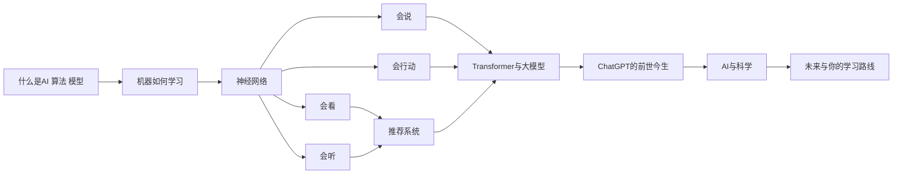

## 路线图

这本书有一条贯穿始终的线索:**人靠眼、耳、口、手和大脑来认识并改变世界,机器也一样。**

## 目录

| 章节 | 你会弄明白的问题 |
|---|---|
| [序言 从一杯奶茶说起](/preface) | 机器是怎么"猜"出你想喝什么的? |
| [第 1 章 什么是 AI](/ch01) | AI 和普通程序有什么区别?AI 的历史有多少起落? |
| [第 2 章 什么是算法与模型](/ch02) | 算法是什么?"模型"和"训练"又是什么? |
| [第 3 章 机器如何学习](/ch03) | 机器靠什么学习?为什么会"死记硬背"? |
| [第 4 章 神经网络是怎样炼成的](/ch04) | 神经元怎么"投票"?为什么叠起来就变聪明? |
| [第 5 章 让机器会看](/ch05) | 电脑怎么认出一只猫? |
| [第 6 章 让机器会听](/ch06) | 手机怎么听懂你说的话? |
| [第 7 章 让机器会说](/ch07) | 机器怎么读懂并写出文字? |
| [第 8 章 让机器会行动](/ch08) | 机器怎么学会下棋、走路、做事? |
| [第 9 章 AI 为什么这么懂你](/ch09) | 推荐系统怎么猜中你的喜好?什么是信息茧房? |
| [第 10 章 Transformer 与大模型](/ch10) | "注意力"是什么?大模型到底"大"在哪? |
| [第 11 章 大模型的前世今生](/ch11) | ChatGPT 是怎样炼成的?它为什么会胡说? |
| [第 12 章 AI 与科学](/ch12) | AI 怎样帮科学家解决蛋白质折叠、天气预报等难题? |
| [第 13 章 互动实验室](/ch13) | 所有互动演示的集合、挑战任务和项目点子 |
| [第 14 章 未来、风险与学习路线](/ch14) | AI 有哪些局限?我该怎么开始学? |
| [术语小词典](/glossary) | 忘了某个词是什么意思?来这里查 |

::: tip 怎么读
顺着章节读最顺;读不懂的地方先跳过,读到后面常常会"啊,原来如此"。每章里的互动演示,**一定要动手玩一玩**。
:::

::: warning 说明
书中涉及的年份、模型名称均为作者尽力核对的大致信息;AI 领域发展很快,具体产品和数字请以最新资料为准。互动演示为教学目的做了简化。
:::
